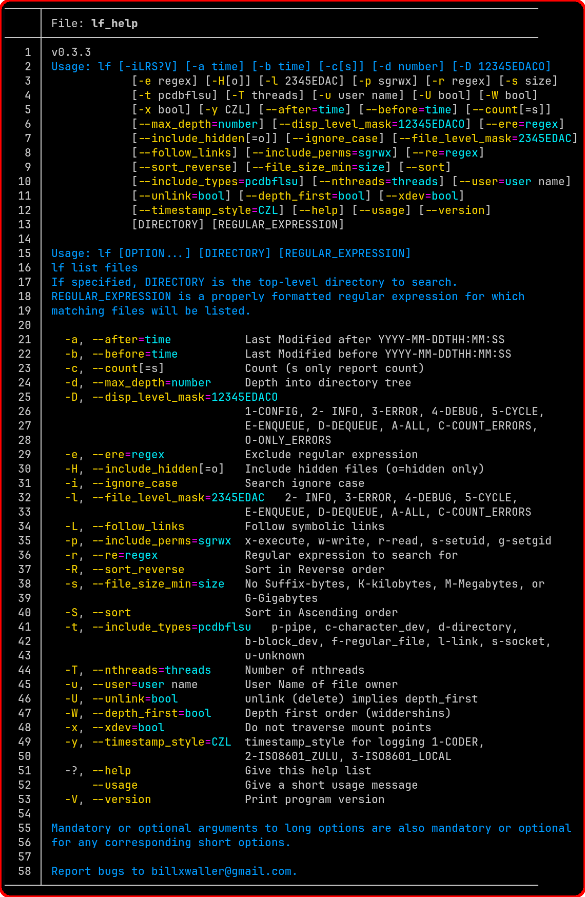
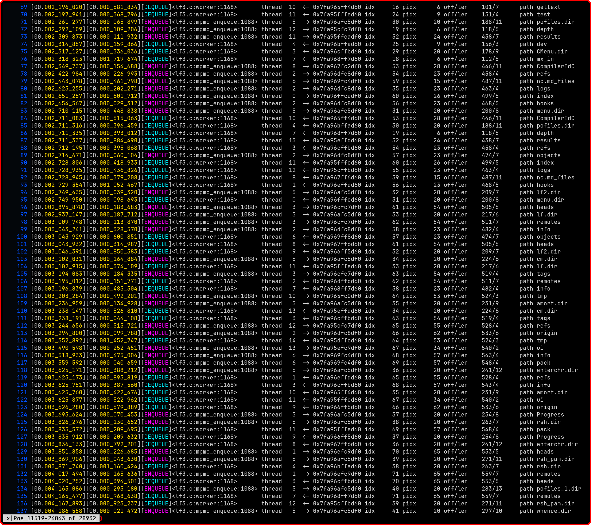

# lf

Moore's Law has hit a wall, and the days of exponential CPU performance growth are over. Nevertheless, consumers still expect performance improvements with each new product generation. Will you be the developer who delivers the performance they want? In the past, you could benefit from rapidly evolving hardware and capitalize on the illusion that your software was delivering the performance, but those days are rapidly coming to an end. You can still get massive performance gains, but consumer competition from Hyper-scale data centers has driven costs through the roof.

The truth is that most users don't care about the number of cores in the CPU, the clock speed, or the number of lines of code. What they care about is snap. They want responsiveness. Press the button. Get the answer immediately, like a light switch. Electricity travels at nearly the speed of light, right? So, why should it take a quarter of a second to find a file. The users are right.

Over the past 30 years, developers have been more concerned with completing development projects on time and within budget than with performance. One prominent industry spokesman even said, "Don't waste time doing anything to make your code faster." And, he was right. Developers were using inherently low performance languages like Java, Python, and C# to build applications that were inherently slow, and that was appropriate for the time. The next generation of machines would fix it. Fast forward to 2026, and all that bloatware is taking a toll on overall system performance. That's why the big data centers, the people who really know the value of compute are using $10,000 GPUs and redesigning their applications in C and C++ to reclaim the value of their investment in hardware.

It's not about the time savings in a single operation, but the cumulative time of perhaps hundreds, thousands, or millions of operations over the course of a day, week, or month. Because a file finder is a core component of applications that deal with large numbers of files, and most do, even if your large file system application is blindingly fast, its performance is capped by the rate of file discovery and filtering by the finder. lf is three to ten times faster than its mainstream competitors and it is the tool that will give your application an astonishing competitive edge.

How do we do it? With the current state of processor technology, the only dependable way to get significant gains in performance is to use more cores, and that means the software has to be specifically designed to take advantage of multiple concurrent threads. That can be notoriously difficult, but lf takes care of it for you. lf is a multi-threaded file finder that leverages multi-core processors to provide lightning fast file discovery and filtering giving your application a real chance to deliver spectacular performance.

lf is a high performance file finder that can be used to generate file lists for pick, shell pipelines, or custom scripts. lf is comparable to the popular find command, but unlike find, lf is extremely user-friendly and ridiculously fast.

To say that lf is fast is understated. It is easily ten times faster than find, and, twice as fast as fd. lf handles huge directories with ease. It can be used to find files based on name, type, date, size, and other attributes, making it a powerful tool for file discovery and filtering. It also has an option that only reports cyclic and broken links.



## What Does lf Stand For?

Some have suggested that lf stands for "lightweight finder", or "lightning fast file finder", while others have suggested that the name is derived from the "lock-free" structures that compose its memory model. The name is not an acronym, but rather a play on words. It is pronounced "el-eff", and it is a nod to the fact that lf is a file finder that is fast, efficient, and easy to use.

## File Finder Comparative Benchmark

Below is the actual output of timings for find, fd, and lf on a directory with
465,412 files. The directory is /home/bill, and it contains a mix of files and directories. The timings were done on a Linux system with a 16 x Intel® Xeon® E5-2670 @ 2.6GHz, 32GB of RAM, and an NVMe SSD.

# File Finder Benchmarks - November 22, 2026

* find (GNU findutils) version 4.11.0
* fd                   version 10.5.0
* lf                   version 0.3.3

Summary:

| Command               | Milliseconds | CPU% | Memory | Faults | Files   |
| --------------------- | ------------ | ---- | ------ | ------ | ------- |
| find /home/bill       | 750          | 99   | 35,228 | 12,004 | 465,413 |
| fd . -H -I /home/bill | 240          | 586  | 51,336 | 13,531 | 465,412 |
| lf -H /home/bill      | 70           | 1069 | 19,008 | 872    | 465,412 |


NOTE: find counts the root directory as a file, while fd and lf do not. This
accounts for the one-file difference in the file counts. This is not necessarily
an error. Just subtract 1 from the find count to get an accurate result.

### Baseline find (GNU findutils) version 4.11.0

```
find /home/bill
0.33user 0.41system 0:00.75elapsed 99%CPU (0avgtext+0avgdata 35228maxresident)k
0inputs+0outputs (0major+12004minor)pagefaults 0swaps
found 465413 files
```

---

### Baseline fd version 10.5.0

```
fd . -H -I /home/bill
0.85user 0.59system 0:00.24elapsed 597%CPU (0avgtext+0avgdata 51336maxresident)k
0inputs+0outputs (0major+13531minor)pagefaults 0swaps
expected 465412 files, found 465412 files
```

---

### Baseline lf version 0.3.3

```
./lf -H /home/bill
0.21user 0.62system 0:00.07elapsed 1069%CPU (0avgtext+0avgdata 19008maxresident)k
0inputs+0outputs (0major+872minor)pagefaults 0swaps
expected 465412 files, found 465412 files
```

---

By default, fd ignores errors, while find and lf report errors to stderr so that they do not get mixed in with normal output on stdout. A permission denied error, for example,  means that the user running the command does not have permission to access the directory. This is helpful information for the user, as it indicates that there may be files in that directory that are not being counted.


## Building lf

---

Initial build:

Change to the source directory, lf/src, and:

1. Generate the Build system inside the "build" folder.

```bash
cmake -B build -DCMAKE_BUILD_TYPE=Release
```

2. Compile the project

```bash
cmake --build build
```

3. Install the binaries (Default prefix is /usr/local)

```bash
sudo cmake --install build
```

---

- To install lf in a custom path (the PREFIX variable from your Makefile), swap step 1 with:

```bash
    cmake -B build -DCMAKE_INSTALL_PREFIX=/your/custom/path \
          -DCMAKE_BUILD_TYPE=Release
```

---

## For Advanced Developers of lf

- To build a Debug variant, toggle the build flag: 

```bash
cmake -B build -DCMAKE_BUILD_TYPE=Debug
```

---

## lf Quality Assurance

If you want to contribute code to lf, you will need to certify that your patches
have been applied to the appropriate lf branch, and that you have successfully
tested the resulting code with valgrind and helgrind. This is to ensure that the code is free of memory leaks and race conditions, and that it meets the quality standards of the lf project.

NOTE: You may also want to test your code with -fsanitize=thread and -fsanitize=address. The distribution releases of lf have been tested with -fsanitize=thread and -fsanitize=address and no errors were found.

### Helgrind output

```
==792531== Helgrind, a thread error detector
==792531== Copyright (C) 2007-2026, and GNU GPL'd, by OpenWorks LLP et al.
==792531== Using Valgrind-3.29.0.GIT and LibVEX; rerun with -h for copyright info
==792531== Command: ./lf -H
==792531== Parent PID: 792529
==792531== 
==792531== 
==792531== Use --history-level=approx or =none to gain increased speed, at
==792531== the cost of reduced accuracy of conflicting-access information
==792531== ERROR SUMMARY: 0 errors from 0 contexts (suppressed: 135 from 10)
--792531-- 
--792531-- used_suppression:    135 helgrind-glibc2X-005 /usr/libexec/valgrind/default.supp:1022
==792531== 
==792531== ERROR SUMMARY: 0 errors from 0 contexts (suppressed: 135 from 10)
```

---

### Valgrind output

```
==797634== Memcheck, a memory error detector
==797634== Copyright (C) 2002-2026, and GNU GPL'd, by Julian Seward et al.
==797634== Using Valgrind-3.29.0.GIT- and LibVEX; rerun with -h for copyright info
==797634== Command: ./lf -H
==797634== Parent PID: 797632
==797634== ==797634== HEAP SUMMARY:
==797634==     in use at exit: 0 bytes in 0 blocks
==797634==   total heap usage: 60 allocs, 60 frees, 8,415,217 bytes allocated
==797634== 
==797634== All heap blocks were freed -- no leaks are possible
==797634== 
==797634== ERROR SUMMARY: 0 errors from 0 contexts (suppressed: 0 from 0)
```
---
---

Before running valgrind or helgrind, you must build the Debug variant of lf. This is because valgrind and helgrind require debug symbols to be present in the binary in order to provide meaningful output. If you try to run valgrind or helgrind on a Release build, you will get a lot of warnings and errors that are not relevant to your code.

### Valgrind and Helgrind How To

- To run valgrind:

```bash
cmake --build build --target valgrind
```

- To run helgrind:

```bash
cmake --build build --target helgrind
```

After running helgrind, you will find the output in src/helgrind/helgrind.out.

### Helgrind Condensed Format

Because the helgrind report is notoriously verbose, circuitous, and difficult to read, we provide our Condensed Format Helgrind report with lf. The native Helgrind output used as input for the following Helgrind Condensed Format was 26 pages long. The Condensed Format is less than 3 pages, and includes a summary of errors, conflicts, and relevant code lines. It is convenient, concise, easy to read, and provides more information than native Helgrind. It's everything you need to and nothing you don't. You get a clear picture of what is going on in the code. Here's how to use it:

After running "make helgrind", change to the src/helgrind directory and run the following command:

```bash
    ./fmt_helgrind.sh
```

This will create a file named helgrind_s1.out in the src/helgrind directory and make backup copies of lf.c and lf.h as lf_1.c and lf_1.h respectively. The numbers appended to the files increment sequentially for each iteration of fmt_helgrind.sh. This will be helpful in the event that your modifications have broken lf and you need to revert to a previous iteration.


```
Helgrind, a thread error detector
Copyright (C) 2007-2026, and GNU GPL'd, by OpenWorks LLP et al.
Using Valgrind-3.29.0.GIT and LibVEX; rerun with -h for copyright info
Command: ./lf4 -H
2026-11-26T23:17:34Z Condensed Format by Bill Waller
```

```
Helgrind Condensed Format - Errors by Context

cntxt errors action size  at_addr by_addr fn                          thread  line
----- ------ ------ ---- -------- ------- ------------------------------ --- -----
    1      1 read      4  56BD600  407D76 release_directory_chain          4  1268
    1        write                 40721E mpmc_bulk_enqueue                8  1078
    2      1 read      1  56BD65A  407BA4 worker                           4  1225
    2        write                 407231 mpmc_bulk_enqueue                8  1078
    3      1 read      4  56BD300  407AE5 worker                           4  1214
    3        write                 40721E mpmc_bulk_enqueue                2  1078
    4      1 read      2  56BD458  407AB5 worker                           4  1213
    4        write                 4072A8 mpmc_bulk_enqueue                2  1078
    5      2 read      2  56BD4DC  407BA4 worker                          15  1225
    5        write                 407231 mpmc_bulk_enqueue                2  1078
    6      2 read      4  56BD600  407D76 release_directory_chain          4  1268
    6        write                 40721E mpmc_bulk_enqueue                8  1078
    7      2 read      4  56BD640  407D4E release_directory_chain          4  1261
    7        write                 407231 mpmc_bulk_enqueue                8  1078
    8      2 write     8  56BD190  40721E mpmc_bulk_enqueue               15  1078
    8        write                 40721E mpmc_bulk_enqueue                8  1078
    9      2 read      4  56BD188  406D54 node_alloc                       8   995
    9        write                 406E15 node_free                        2  1011
   10      2 read      2  56BD358  407C82 worker                           4  1238
   10        write                 407231 mpmc_bulk_enqueue                2  1078
   11      3 read      4  56BD304  40843B finder                           8  1392
   11        write                 40721E mpmc_bulk_enqueue                2  1078
   12      3 write     4  56BD188  406E15 node_free                        8  1011
   12        write                 406E15 node_free                        2  1011
   13      3 write     8  56BD1C8  407231 mpmc_bulk_enqueue               15  1078
   13        write                 407231 mpmc_bulk_enqueue                8  1078
   14      3 write     4  56BD1C0  407231 mpmc_bulk_enqueue                8  1078
   14        read                  407D4E release_directory_chain          2  1261
   15      3 read      1  56BD658  407BA4 worker                           4  1225
   15        write                 407231 mpmc_bulk_enqueue                8  1078
   16      3 read      4  56BD300  407A93 worker                           8  1211
   16        write                 40721E mpmc_bulk_enqueue                2  1078
   17      3 read      2  56BD458  407A39 worker                           8  1206
   17        write                 4072A8 mpmc_bulk_enqueue                2  1078
   18      3 write     4  4AB2310  407705 mpmc_dequeue                     8  1135
   18        write                 407453 mpmc_bulk_enqueue                2  1093
   19      3 read      4  4AB2314  4076B0 mpmc_dequeue                     8  1134
   19        write                 407429 mpmc_bulk_enqueue                2  1092
   20      4 read      4  4AB2310  40761F mpmc_dequeue                     8  1123
   20        write                 407453 mpmc_bulk_enqueue                2  1093
   21      4 write     4  4AB2308  407453 mpmc_bulk_enqueue                2  1093
   21        read                  40761F mpmc_dequeue                    16  1123
   22      4 write     8  56BD2E0  4072B8 mpmc_bulk_enqueue               15  1078
   22        write                 4072B8 mpmc_bulk_enqueue                8  1078
   23      4 write     8  56BD2C0  4072A8 mpmc_bulk_enqueue               15  1078
   23        write                 4072A8 mpmc_bulk_enqueue                8  1078
   24      4 write     8  56BD2A0  407298 mpmc_bulk_enqueue               15  1078
   24        write                 407298 mpmc_bulk_enqueue                8  1078
   25      4 write     8  56BD280  407288 mpmc_bulk_enqueue               15  1078
   25        write                 407288 mpmc_bulk_enqueue                8  1078
   26      4 write     8  56BD260  407278 mpmc_bulk_enqueue               15  1078
   26        write                 407278 mpmc_bulk_enqueue                8  1078
   27      4 write     8  56BD240  407268 mpmc_bulk_enqueue               15  1078
   27        write                 407268 mpmc_bulk_enqueue                8  1078
   28      4 write     8  56BD220  407258 mpmc_bulk_enqueue               15  1078
   28        write                 407258 mpmc_bulk_enqueue                8  1078
   29      4 write     8  56BD200  407248 mpmc_bulk_enqueue               15  1078
   29        write                 407248 mpmc_bulk_enqueue                8  1078
   30      4 write     8  56BD1E0  40723B mpmc_bulk_enqueue               15  1078
   30        write                 40723B mpmc_bulk_enqueue                8  1078
   31      4 write     8  56BD1A0  407227 mpmc_bulk_enqueue               15  1078
   31        write                 407227 mpmc_bulk_enqueue                8  1078
   32      6 read      2  56BD358  407BA4 worker                           8  1225
   32        write                 407231 mpmc_bulk_enqueue                2  1078
      ------
          97 total errors
```

```
Helgrind Condensed Format - Line Number Cross Reference

line_no errors Conflicts
------- ------ -------------------------------------------------
   995r      2  1011w
  1011w      8  1011w  995r
  1078w    123  1078w 1206r 1211r 1213r 1214r 1225r 1238r 1261r 1268r 1392r
  1092w      3  1134r
  1093w     11  1123r 1135w
  1123r      8  1093w
  1134r      3  1092w
  1135w      3  1093w
  1206r      3  1078w
  1211r      3  1078w
  1213r      1  1078w
  1214r      1  1078w
  1225r     12  1078w
  1238r      2  1078w
  1261r      5  1078w
  1268r      3  1078w
  1392r      3  1078w
        ------ 
total      194 (2 x 97) 
```

```c
Helgrind Condensed Format - Relevant Code Listing

   >>> __G->queue[idx].next_free

       static inline uint32_t node_alloc(GlobalContext *__G) {
   995	        uint32_t next = __G->queue[idx].next_free;

       static inline void node_free(GlobalContext *__G, uint32_t idx) {
  1011	        __G->queue[idx].next_free = (uint32_t)head;
```

```c

   >>>  __G->queue[pos & QUEUE_MASK]

       bool mpmc_bulk_enqueue(GlobalContext *__G, ThreadLocal *__tl) {
  1078	        *dst = __tl->stage[i];

       void *worker(void *arg) {
  1206	        uint32_t q_path_len = __G->queue[q_pos].name_len;
  1211	        uint32_t parent_idx = __G->queue[q_pos].parent_idx;
  1213	            cum_path_len += __G->queue[parent_idx].name_len + 1;
  1214	            parent_idx = __G->queue[parent_idx].parent_idx;
  1225	        memcpy(&__tl.path[write_cursor],
  1226	               &__G->queue[q_pos].name, __G->queue[q_pos].name_len);
  1238	            memcpy(&__tl.path[write_cursor],
  1239	                   &__G->queue[parent_idx].name,
  1240	                   __G->queue[parent_idx].name_len);
  1261	        uint32_t prev = atomic_fetch_sub_explicit(
  1262	            &__G->queue[curr].child_dirs_remaining,
  1263	            1,
  1264	            memory_order_acq_rel);
  1268	            uint32_t parent = __G->queue[curr].parent_idx;

       void *finder(GlobalContext *__G, ThreadLocal *__tl) {
  1392	                __tl->depth = __G->queue[__tl->queue_idx].depth + 1;
```

```c

   >>>  slot->node_idx
   >>>  __G->ring[pos & QUEUE_MASK].node_idx

       bool mpmc_bulk_enqueue(GlobalContext *__G, ThreadLocal *__tl) {
  1092	                    slot->node_idx = allocated_indices[i];

       bool mpmc_dequeue(GlobalContext *__G, uint32_t *out_node_idx) {
  1134	                *out_node_idx = __G->ring[pos & QUEUE_MASK].node_idx;allocated_indices
```

```c

   >>> slot->sequence
   >>> __G->ring[pos & QUEUE_MASK].sequence

       bool mpmc_bulk_enqueue(GlobalContext *__G, ThreadLocal *__tl) {
  1093	                    atomic_store_explicit(&slot->sequence, pos + 1, memory_order_release);
 
       bool mpmc_dequeue(GlobalContext *__G, uint32_t *out_node_idx) {
  1123	        uint32_t seq = atomic_load_explicit(&slot->sequence, memory_order_acquire);
  1135	                atomic_store_explicit(&__G->ring[pos & QUEUE_MASK].sequence, pos + QUEUE_NODES, memory_order_release);
```

Of course, we wouldn't distribute lf with helgrind or valgrind errors. Here's
what it looks like when you run lf with helgrind and no errors are found:

```
Helgrind, a thread error detector
Copyright (C) 2007-2026, and GNU GPL'd, by OpenWorks LLP et al.
Using Valgrind-3.29.0.GIT and LibVEX; rerun with -h for copyright info
Command: ./lf -H
2026-11-21T20:56:49Z Condensed Format by Bill Waller

cntxt errors action size  at_addr by_addr fn                          thread  line
----- ------ ------ ---- -------- ------- ------------------------------ --- -----
      ------
           0 total errors

      0       0 Conflicts
         ------ -------------------------------------------------
total         0 (2 x 0) 
---
```

### Logging



Above is a screenshot of an lf debugging log in view. Notice that it uses a "Coders Timestamp" instead of the usual ISO_8601 timestamp. The Coders Timestamp is a pair of 64-bit integers that represent the number of milliseconds, microseconds, and nanoseconds elapsed since the program was started as well as an interval timer to track time between log entries. It is used for high-resolution timing and logging in lf, and it provides a far more precise measure of time than the standard ISO_8601 format. Most importantly, it contains meaningful information for developers who are debugging and profiling the performance of lf.

***NOTE:*** Each thread has it's own interval timer, so the Coders Timestamp is not a global timer. It is a per-thread timer that is used to track the time between log entries for each thread. This allows developers to see how long each thread is taking to execute, and to identify any threads that are taking longer than expected. The Coders Timestamp is a valuable tool for debugging and profiling the performance of lf, and it can help developers optimize their code for maximum performance.

### Build Shortcuts

Note: You can build lf with a simple compile command such as:

```bash
clang -std=c23 lf.c -o lf
```

or

```bash
cc -std=gnu2y lf.c -o lf
```

However, you wont get the benefits of the CMake build system, such as easy configuration, dependency management, cross-platform support, integrated valgrind and helgrind actions, and language support.

The CMake build creates a file in the lf/src directory named compile_commands.json which is used by many IDEs and code editors to provide code completion, navigation, and other features. And, you can also use the CMake build system to generate project files for your IDE or code editor, so that you can use its built-in build and run features.

Therefore, it is recommended to use CMake for building lf, at least initially.
Once the compile_commands.json file is generated, you can use your favorite IDE
or code editor to build and run lf, and to debug and profile it. 

## Limitations

lf currently supports 1024 * 1024 = 1,048,576 directories, which should be equivalent to about 10 million files, assuming an average of 10 files per directory. This was a temporary compromise, resulting in a 4 Mb ring buffer that would comfortably fit in stack space, even on legacy systems, without pruning exhausted nodes. To take full advantage of the ring buffer topology, it is essential to prune exhausted nodes as they are encountered. This will allow lf to traverse a virtually unlimited number of directories, reduce the sequence array size, and improve performance. This work is underway, and it is expected to be completed in the near future. Once this work is completed, lf will be able to handle virtually unlimited numbers of directories and files, making it an even more powerful tool for file discovery and filtering.
